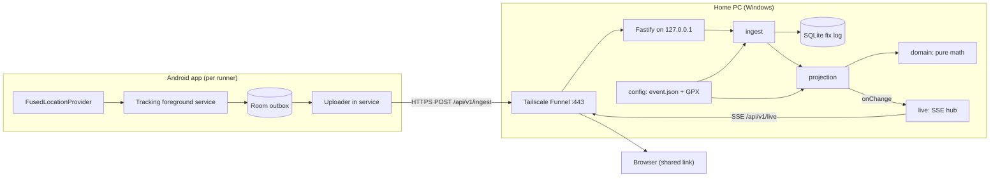
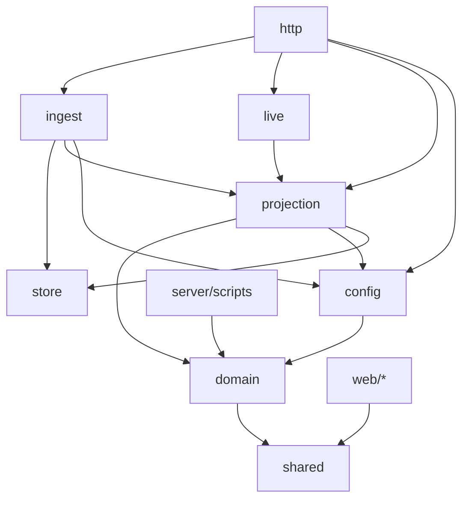
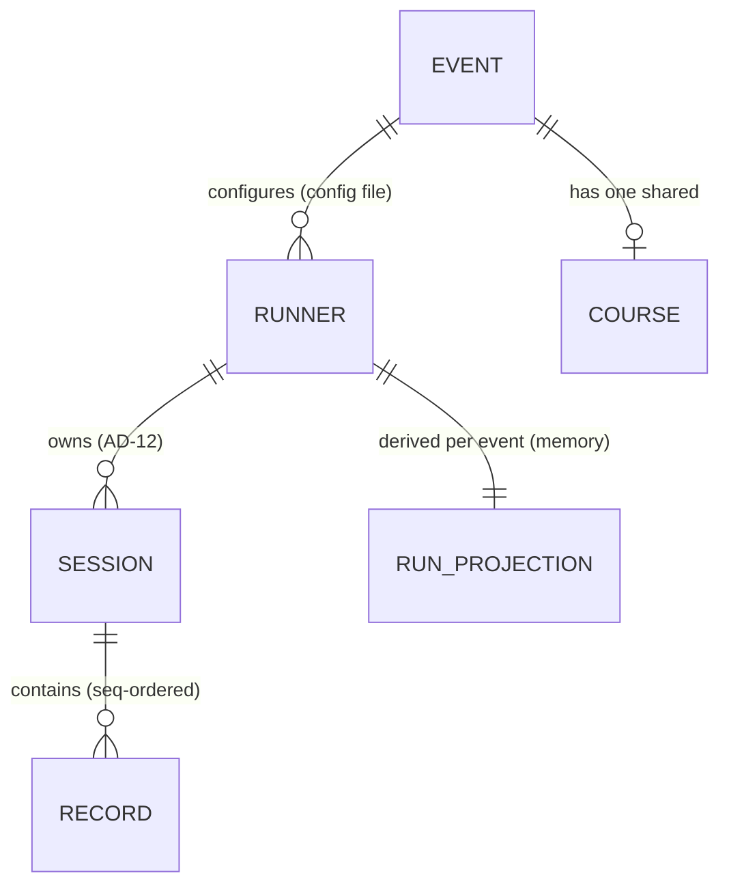
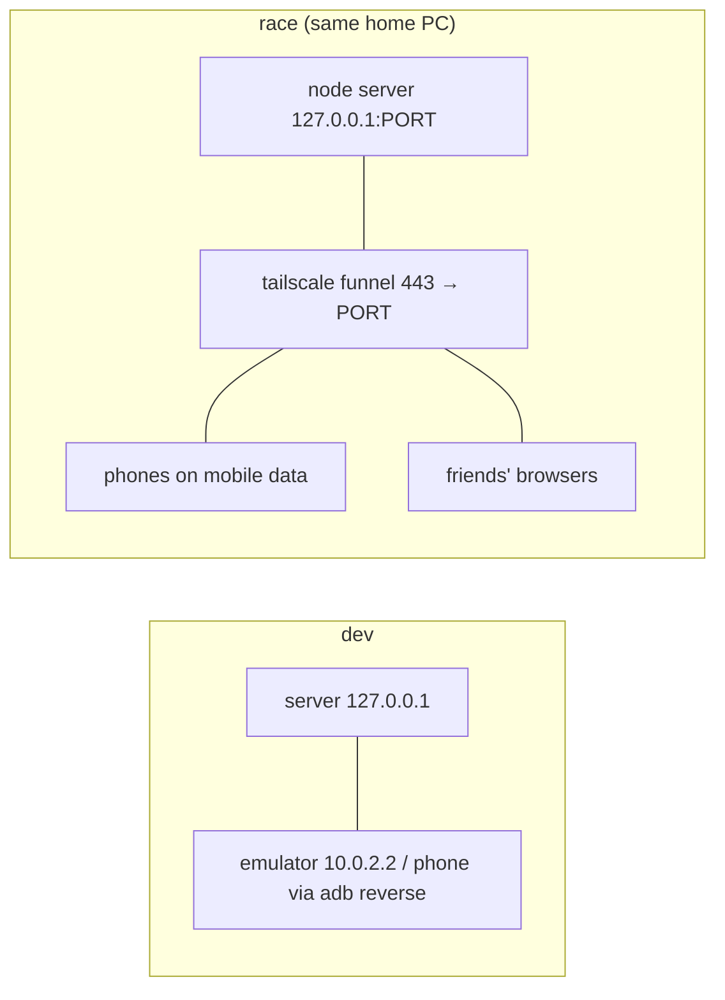

# Architecture Spine — running-live-tracker

## Design Paradigm

**Append-only fix log + derived projections (CQRS-lite)** on the server, fed by a **store-and-forward outbox** on the phone.

- **Write side:** the phone records raw GPS fixes into a local outbox and sends them oldest-first. The server appends them to an immutable fix log (SQLite). Nothing else is ever the source of truth.
- **Read side:** per-runner projections (stats, course progress, ETA, track) are a pure fold over the log in canonical order. They are held in memory, rebuilt from the log at boot, and pushed to browsers over SSE.
- **Viewers are dumb renderers:** they display server-computed values and tick only wall-clock values locally.



## Invariants & Rules

Dependency direction (an arrow means "may import"; anything not drawn is forbidden). Every server module and `web` may also import `shared`. `server/src/main.ts` is the only composition root and may import anything. The graph is enforced by `dependency-cruiser` in CI and pre-commit.



### AD-1 — The fix log is the only source of truth

- **Binds:** all
- **Prevents:** stats or progress stored as mutable rows that drift from the positions, and two modules writing positions.
- **Rule:** Only `server/src/ingest` writes, through `server/src/store`, and only by inserting into `sessions` / `records`. It never updates or deletes, except the one-time session-owner insert in AD-12. Derived values (distance, pace, progress, ETA, status) are never persisted. They live in `server/src/projection` and are rebuilt at boot by replaying the log in canonical order (AD-4). After a crash or restart the server must reach the identical state from the SQLite file plus the config alone.

### AD-2 — Only the server computes derived numbers

- **Binds:** CAP-3, CAP-4, CAP-5, CAP-7
- **Prevents:** phone, web, and server showing different distance, pace, ETA, or staleness for the same runner.
- **Rule:**
  - The phone sends raw records only and shows no race stats. Every formula lives in `server/src/domain` as a pure function with unit tests.
  - The web never recomputes distance, pace, progress, or ETA. It computes only two values locally, using `now = Date.now() + offsetMs`:
    - elapsed = `(runEndedAt ?? now) − runStartedAt`
    - staleness age = `max(0, now − lastReceivedAt)`
  - `offsetMs = serverNow − Date.now()`, taken from the `serverNow` field carried by **every** SSE payload (AD-6).
  - Formatting (min/km, h:mm:ss, km with 1 decimal) happens only in the web.

### AD-3 — Outbox protocol: sessions, seq, batches, acks

- **Binds:** CAP-1, CAP-6, CAP-7
- **Prevents:** duplicate fixes on resend, lost fixes, an outbox jammed by one bad record, and phone and server disagreeing about what was delivered.
- **Rule:**
  - **Sessions and seq.** Start creates a session: `sessionId` (UUIDv4), `sessionStartedAt`, and the runner key captured at that moment. Each record gets `seq`, a counter that starts at 0 and increases by 1 within the session.
  - **Batches.** A batch carries records of **exactly one** session in increasing seq order, at most 200 records. The uploader always sends the oldest remaining session first, starting from that session's lowest remaining seq.
  - **Server side.** The server inserts the whole batch in **one SQLite transaction** with insert-or-ignore on `(sessionId, seq)`. It replies `200 IngestAck {sessionId, ackedThroughSeq, serverNow}`, where `ackedThroughSeq` = the last seq of the committed batch.
  - **Deleting from the outbox.** The phone deletes `WHERE sessionId = ack.sessionId AND seq ≤ ack.ackedThroughSeq` and nothing else.
  - **Errors.**
    - `400` (schema), `409` (AD-12), and `413` are final for that batch: the phone moves its rows into a local `quarantine` table and carries on.
    - Network errors, `5xx`, `401`, and `429` leave the outbox untouched and are retried with capped exponential backoff (max 60 s) until the outbox is empty.
  - **Validation before enqueue.** The phone validates each record before enqueueing. It drops fixes that have no accuracy or have non-finite coordinates.

### AD-4 — Canonical fold: one run per runner per event, status machine

- **Binds:** CAP-1, CAP-2, CAP-3, CAP-4, CAP-5
- **Prevents:** live state differing from replayed state, an accidental Stop/Start resetting the run, and elapsed or pace drifting after the finish.
- **Rule:**
  - **One run.** A runner's run is all of their sessions in the active event (AD-12), folded in canonical order `(sessionStartedAt, sessionId, seq)` by one function, `applyRecords(state, records)`. The live path and the boot replay both call it.
  - **Accepted fixes.** A single predicate, `isAccepted(fix, state)`, decides which fixes count: `kind = fix ∧ accuracyM ≤ 30 ∧ recordedAt > state.lastAppliedAt`. Only accepted fixes feed `runStartedAt`, `lastFixAt`, `lastPosition`, the track, distance, and the pace window. Every stored record of the runner (accepted or not) updates `lastReceivedAt`, which is server `receivedAt`.
  - **Records after `end`.** Records with seq greater than their session's `end` record are stored but ignored.
  - **Elapsed.** `elapsedS = (lastAccepted.recordedAt − runStartedAt) / 1000`.
  - **Status transitions:**

    | From | Trigger | To | Side effect |
    | --- | --- | --- | --- |
    | `notStarted` | first accepted fix | `active` | sets `runStartedAt` |
    | `active` | `end` record of the latest session | `stopped` | sets `runEndedAt` = the end's `recordedAt` |
    | `stopped` | accepted fix in a newer session | `active` | clears `runEndedAt` |

  - **While `stopped`.** `currentPaceSPerKm` and `etaAt` are `null`.
  - **Proof.** A test replays a DB built from an arbitrary interleaving of batches and checks that it produces `RunnerView`s deep-equal to the live state.

### AD-5 — Runner identity comes only from the key

- **Binds:** CAP-6
- **Prevents:** a phone claiming another runner, key/hash encoding mismatches, and keys leaking through git or public endpoints.
- **Rule:**
  - **Request.** `Authorization: Bearer <runnerKey>`. The body never carries a runner id.
  - **Key format.** The key is 32 random bytes encoded as base64url without padding (43 chars).
  - **Hash.** `keyHash` = lowercase hex SHA-256 of the key's UTF-8 bytes. One `hashKey()` in `server/src/domain` is used by both keygen and auth. The comparison is constant-time.
  - **Config validation.** The config schema enforces `/^[0-9a-f]{64}$/` and unique `runnerId` and `keyHash` values.
  - **Rejection.** An unknown key gets `401 UNAUTHORIZED` and nothing is stored.
  - **Phone side.** The phone trims the key and validates its format on entry. Changing the key is blocked while a session is active. Each batch is authenticated with the key captured by its own session (AD-3).
  - **Repo and public endpoints.** Only `*.example.json` config is committed. No public payload contains `keyHash` (AD-9).
  - **Read endpoints** (`/`, `/api/v1/snapshot`, `/api/v1/live`, `/api/v1/course`, `/api/v1/health`) need no auth.

### AD-6 — Live delivery: SSE, snapshot-then-replace, single emitter

- **Binds:** CAP-2, CAP-3, CAP-7
- **Prevents:** clients mis-merging partial patches, stale state after a reconnect, duplicate or missing broadcasts, and silent buffering by proxies.
- **Rule:**
  - **Endpoint and headers.** `GET /api/v1/live` sends `Content-Type: text/event-stream` and `Cache-Control: no-cache, no-transform`, with no compression. It writes to the raw reply (Fastify `reply.hijack()`).
  - **Event names.** Events use named `event:` fields, exactly `snapshot | runner | track`. Each `data:` is the bare zod payload from AD-9.
    - `snapshot` is sent once on connect.
    - `runner` carries a full `RunnerView` that **replaces** the previous one.
    - `track` carries points the client **appends**.
  - **Single emitter.** The projection is the only emitter. It calls `onChange({runnerId, view, appendedPoints})` **after** the store transaction commits, and `live` is its only subscriber. Ingest routes never call `live`.
  - **Per change.** The server emits `track` (only if points were appended), then `runner`. It emits nothing if the view is unchanged and no points were appended.
  - **Heartbeat and reconnect.** A `: ping` comment goes out every 20 s. When the connection drops, the client throws away its state and reconnects to get a fresh snapshot. `Last-Event-ID` replay is not used.
  - **Fallback.** `GET /api/v1/snapshot` returns the same `Snapshot` and is the only fallback (polled every 5 s).
  - **Course geometry.** It comes from `GET /api/v1/course` (only when `hasCourse`) and is never sent over SSE.

### AD-7 — Course progress: forward-only projection with re-acquire

- **Binds:** CAP-4, CAP-5, CAP-3
- **Prevents:** progress jumping across course crossings or out-and-back legs, progress freezing for the rest of the race after a gap or a late Start, and two meanings of "distance".
- **Rule:**
  - **Loading the GPX.** The course GPX is resolved relative to the directory containing `event.json`. The loader concatenates all `trkseg`s of the first `trk`, falling back to the first `rte`, and refuses to boot when there are fewer than 2 points. It builds a polyline with cumulative haversine distance (`lengthM`) using `domain` functions.
  - **Matching window.** Each accepted fix is matched only inside the forward window `[progressM − 50 m, progressM + max(1000 m, 8 m/s × seconds since last match)]`.
  - **Off course.** A fix more than 100 m from the windowed segment leaves `progressM` unchanged and sets `offCourse: true`.
  - **Re-acquire.** After 6 consecutive off-course fixes that are within 100 m of the course *ahead* of `progressM`, progress jumps to the nearest such forward point.
  - **Never backwards.** `progressM` never decreases.
  - **Distance.** With a course, `distanceM = progressM`. Without one, `distanceM` = sum of the segments between consecutive accepted fixes.
  - **No course.** `hasCourse = false`, so `progressM`, `remainingM`, `progressFraction`, and `etaAt` are `null` (never 0), and `/api/v1/course` returns `404 NO_COURSE`.
  - **Constants.** All thresholds are named constants in `server/src/domain`.

### AD-8 — Pace and ETA definitions

- **Binds:** CAP-3, CAP-5
- **Prevents:** pace windows or ETA formulas differing between places or changing silently.
- **Rule:**
  - **Average pace.** `avgPaceSPerKm = elapsedS / (distanceM / 1000)`, and `null` while `distanceM < 100`.
  - **Current pace.** `currentPaceSPerKm` is computed over the trailing accepted fixes covering at least 60 s **and** at least 200 m, measured on the same basis as `distanceM`. It is `null` until that much exists, and `null` when stopped.
  - **ETA.** `etaAt = lastFixAt + remainingM × avgPaceSPerKm / 1000`, and it exists only when `hasCourse`, `active`, and `distanceM ≥ 1000`.
  - **One definition each.** Each value is defined in exactly one function in `server/src/domain`.
  - `[ASSUMPTION]` The window sizes and basing ETA on average pace are guesses, to revisit after the test run.

### AD-9 — Wire contract in `shared/`, mirrored by fixtures

- **Binds:** all
- **Prevents:** server, web, and Android inventing their own payload shapes or field semantics, coordinate-order mix-ups, and config secrets leaking into public payloads.
- **Rule:** `shared/src/contract.ts` (zod schemas + inferred types) is the only definition of the wire shapes:
  - `FixRecord {seq, kind:"fix", recordedAt, lat, lon, accuracyM, altitudeM?, speedMps?}`
  - `EndRecord {seq, kind:"end", recordedAt}`
  - `IngestBatch {sessionId, sessionStartedAt, records: (FixRecord|EndRecord)[]}`
  - `IngestAck {sessionId, ackedThroughSeq, serverNow}`
  - `ErrorBody {error: {code, message}}`
  - `EventInfo {eventId, name, hasCourse, lengthM|null, runners: [{runnerId, displayName, color:"#rrggbb"}]}`: a `.strict()` public schema, never built by spreading the config object.
  - `TrackPoint {lat, lon, recordedAt}`: objects, never tuples. GeoJSON `[lon,lat]` appears only in the `/course` response.
  - `RunnerView {runnerId, status, runStartedAt, runEndedAt, lastFixAt, lastReceivedAt, lastPosition {lat,lon}, distanceM, progressM, remainingM, progressFraction (0..1), offCourse, avgPaceSPerKm, currentPaceSPerKm, etaAt}`. Every field except `runnerId`, `status`, `distanceM`, and `offCourse` is nullable.
  - `Snapshot {serverNow, event: EventInfo, runners: RunnerView[], tracks: Record<runnerId, TrackPoint[]>}`. It includes every configured runner, with empty arrays and `notStarted` where there is no data.
  - SSE `runner` = `{serverNow, view: RunnerView}`; `track` = `{serverNow, runnerId, points: TrackPoint[]}`.

  Contract rules:
  - Optional fields are **omitted, never `null`**, on the ingest side. Kotlin uses `explicitNulls = false`.
  - The server validates every ingest body against the schema.
  - Android hand-writes matching Kotlin classes and must pass contract tests that encode and decode `shared/fixtures/*.json`. The fixtures include optional fields left out and the allowed numeric ranges (`lat ∈ [-90,90]`, `lon ∈ [-180,180]`, `accuracyM > 0`).
  - A contract change updates the schema, the fixtures, and the Kotlin classes in the same change.
  - The API is versioned by path (`/api/v1`).

### AD-10 — Phone: one foreground service owns tracking, outbox writes, and draining

- **Binds:** CAP-1, CAP-7
- **Prevents:** tracking dying with the screen locked, duplicate seq numbers from two writers, and the last kilometres stranded on the phone after Stop.
- **Rule:**
  - **One service.** A single `TrackingService` owns the session state. It is the **only** writer of seq numbers and outbox rows, and it allocates the seq and inserts the row in one Room `@Transaction` on a single-threaded writer.
  - **Start and Stop.** Both are commands sent *to* the service. On Stop, the service removes location updates, drains pending callbacks, then writes `end`.
  - **Foreground types.** While tracking, the service runs in the foreground with type `location` and a persistent notification. Fixes come from `FusedLocationProviderClient` at 5 s, high accuracy, and each fix is written to the outbox before any network attempt.
  - **Draining after Stop.** The service stays in the foreground in a `DRAINING` state (type `dataSync`, notification "Uploading N pending"). It calls `stopSelf()` only when the outbox is empty.
  - **Uploader.** The uploader is a coroutine owned by the service. It flushes every 10 s and right away when connectivity returns. WorkManager and JobScheduler are not used.
  - **Permissions and settings.** The app holds `ACCESS_FINE_LOCATION`, `ACCESS_BACKGROUND_LOCATION` ("Allow all the time"; it is sideloaded, not on the Play Store), `FOREGROUND_SERVICE`, `FOREGROUND_SERVICE_LOCATION`, `FOREGROUND_SERVICE_DATA_SYNC`, and `POST_NOTIFICATIONS`. It also asks to be exempted from battery optimization. Permissions are granted at setup, before the first `startForeground`.
  - **Restarts.** The service returns `START_STICKY`. A restart by the OS resumes the **same** session from the persisted state. Launching the app restarts draining if the outbox is not empty.

### AD-11 — Exposure: localhost-only server behind Tailscale Funnel

- **Binds:** all (operational)
- **Prevents:** code tied to one tunnel product, the server being exposed directly, and cleartext keys on the network.
- **Rule:**
  - **Bind address.** Fastify binds `127.0.0.1` only, in every environment.
  - **Public access.** The only public access is Tailscale Funnel on port 443, with the URL `https://<machine>.<tailnet>.ts.net` (no domain, no port in the URL). `[ADOPTED]`
  - **Tunnel-agnostic code.** No code reads tunnel-specific headers or hostnames.
  - **Phone settings.** The phone stores `baseUrl` + `runnerKey` in DataStore. Release builds allow HTTPS only.
  - **Dev access.** A physical phone reaches the dev server through `adb reverse`, and the emulator through `10.0.2.2`. A **debug-only** network security config allows cleartext to `localhost`/`10.0.2.2`.
  - **Forbidden:** Cloudflare Quick Tunnels (no SSE support), router port forwarding, and a raw public IP.
  - **Fallback.** A named Cloudflare Tunnel is the only alternative, and only if a domain is ever acquired.

### AD-12 — Session ownership and event scoping

- **Binds:** CAP-1, CAP-4, CAP-6
- **Prevents:** test-run or leftover outbox data joining the race run, and one session being credited to two runners.
- **Rule:**
  - **Ownership.** `store` keeps `sessions (sessionId PK, runnerId, sessionStartedAt, firstReceivedAt)`, inserted once by ingest on the session's first batch using the authenticated runner. A later batch for that `sessionId` under a different runner gets `409 SESSION_OWNER_MISMATCH`.
  - **Event window.** The event config has `opensAt` and `closesAt` (epoch ms). The projection includes only sessions whose `sessionStartedAt ∈ [opensAt, closesAt]`. Sessions outside the window are stored and acked but never shown.
  - **Test run vs race.** The pre-marathon test run and the race are separate event configs with their own windows, sharing one DB.

### AD-13 — Testing strategy

- **Binds:** all
- **Prevents:** each story picking its own test tooling, and race-critical paths (replay, offline, background) going unverified.
- **Rule:**
  - **Server and shared.** Tests use `node:test`.
  - **Domain.** Golden tests from GPX fixtures cover an out-and-back course, a lap course, a late Start, a 2 km gap, and no course.
  - **Projection.** A live-equals-replay test (AD-4), plus a restart test against a temp SQLite file.
  - **Simulator.** `server/scripts/simulate-runner` replays a GPX as one or more runners, with configurable offline gaps, through the real HTTP API. It is the integration test for CAP-2/CAP-7 and the pre-race smoke test.
  - **Android.** JVM contract tests against `shared/fixtures` and uploader tests with OkHttp MockWebServer (ack, 400 quarantine, 401 retry).
  - **Manual, before the race.** A ≥ 5 h soak with the phone pocketed and the screen locked, on each runner's own phone.

### AD-14 — Race-readiness operations

- **Binds:** all (operational)
- **Prevents:** the home PC going quietly unavailable on race day (sleep, update reboot, a process not restarted), and a corrupt backup.
- **Rule:** The PC is race-ready when **all** of these hold:
  - Windows sleep and hibernate are disabled.
  - Windows Update is paused for race week.
  - The server and Tailscale start automatically at logon, and auto-logon is enabled.
  - `GET /api/v1/health` returns `200 {ok, serverNow, eventId}`.
  - The day before, `simulate-runner` has passed through the **public** URL with a phone browser watching.
  - Backups use better-sqlite3 `db.backup()`, never a file copy of a WAL database.

## Consistency Conventions

| Concern | Convention |
| --- | --- |
| Naming | TS: camelCase fields, PascalCase types, kebab-case files. Kotlin: standard style. Fixed domain terms: **event, runner, session, record, fix, run, course, progress, track**. "Track" means the runner's recorded points, never the course. |
| Ids | `runnerId` / `eventId`: slugs from config. `sessionId`: UUIDv4 made by the phone. `seq`: integer from 0. |
| Time | Integer epoch **ms UTC** everywhere. `recordedAt` is phone `Location.getTime()`. `receivedAt` and `serverNow` are the server clock. Local time zones only at display. |
| Units | SI on the wire and in storage. The field-name suffix states the unit (`distanceM`, `elapsedS`, `accuracyM`, `speedMps`, `…SPerKm`). Fractions are 0..1. |
| Errors | Every non-2xx body is `{error: {code, message}}` with a stable SCREAMING_SNAKE `code` (`UNAUTHORIZED`, `INVALID_BATCH`, `BATCH_TOO_LARGE`, `SESSION_OWNER_MISMATCH`, `NO_COURSE`). Clients branch on status + code, never on message text. |
| Config | `config/event.json` (git-ignored): `{eventId, name, opensAt, closesAt, coursePath?, runners: [{runnerId, displayName, color, keyHash}]}`. It is validated by zod at boot and read-only at runtime; changes need a restart. Port and data dir come from env vars with defaults. |
| TS runtime | Node native type stripping: erasable syntax only (no enums, parameter properties, or namespaces), relative imports with `.ts` extensions, `import type` for types, no `paths` aliases. pnpm `injectWorkspacePackages` stays off. `tsc --noEmit` is the only type checker. |
| Logging | Fastify's pino logs JSON lines to `data/logs`. It never logs raw keys or request bodies. Ingest logs per-batch clock skew (`receivedAt − max recordedAt`). |
| Web state | One store module holds `Snapshot` state. It is changed only by applying SSE events (AD-6), and UI modules subscribe read-only. |

## Stack

| Name | Version |
| --- | --- |
| Node.js LTS (native type stripping) | 24.22.0 |
| TypeScript (type-check only) | 7.0.2 |
| @types/node | 24.19.2 |
| pnpm (workspaces `server`, `web`, `shared`; pinned via `packageManager`) | 12.11.2 |
| Fastify | 5.12.7 |
| @fastify/static | 10.1.6 |
| better-sqlite3 (WAL) | 13.0.3 |
| @types/better-sqlite3 | 9.6.0 |
| zod | 4.6.7 |
| dependency-cruiser | 18.6.0 |
| Vite (vanilla TS) `[ASSUMPTION]` no UI framework | 8.3.4 |
| Leaflet (OSM standard tiles, with attribution) | 1.9.4 |
| Kotlin Gradle plugin + `org.jetbrains.kotlin.plugin.compose` (AGP built-in Kotlin; no `kotlin-android` plugin, no kapt) | 2.4.21 |
| KSP (Room) | 2.3.12 |
| Android Gradle Plugin | 9.4.1 |
| compileSdk / targetSdk / minSdk | 37 / 36 / 29 |
| Compose BOM | 2026.09.00 |
| Room | 2.8.5 |
| DataStore Preferences | 1.2.1 |
| play-services-location | 21.4.0 |
| Tailscale (Funnel) | 1.104.1 |

## Structural Seed

```text
running-live-tracker/
  android/                 # Gradle project, single :app module (Compose UI, TrackingService, Room outbox+quarantine, uploader)
  server/src/
    config/                # load + validate event.json, build course polyline
    store/                 # SQLite access; the only place that touches the DB
    ingest/                # auth (AD-5), validation, session ownership (AD-12), append (AD-1, AD-3)
    domain/                # pure geo/pace/progress/ETA/hashKey functions — no I/O
    projection/            # applyRecords fold, RunnerView per runner, onChange emitter
    live/                  # SSE hub (AD-6)
    http/                  # Fastify routes, static web hosting, health
    main.ts                # composition root
  server/scripts/          # keygen, simulate-runner, backup
  web/src/                 # Vite app: live client, store, map, runner list, stats panel
  shared/src/contract.ts   # wire contract (AD-9)
  shared/fixtures/         # canonical JSON + GPX samples used by server, web and Android tests
  config/                  # event.example.json (committed); event.json + courses/*.gpx (ignored)
  data/                    # SQLite file, backups, logs (ignored)
```





- There are two environments, **dev** and **race**, on one codebase. They differ only in env vars and `config/event.json`.
- Vite builds `web` into a folder that the server serves at `/`. In production there is one Node process plus the Tailscale daemon, with no containers.
- The PC must meet the race-readiness checklist (AD-14).

## Capability → Architecture Map

| Capability / Area | Lives in | Governed by |
| --- | --- | --- |
| CAP-1 start/stop tracking, send fixes | `android` TrackingService + uploader; `server/ingest` | AD-3, AD-4, AD-10, AD-12 |
| CAP-2 live map of all runners | `server/projection` + `live`; `web` map + store | AD-6, AD-9 |
| CAP-3 per-runner stats, switch runner | `server/domain` + `projection`; `web` stats panel | AD-2, AD-4, AD-7, AD-8 |
| CAP-4 shared GPX + progress | `server/config`, `server/domain`, `/api/v1/course`; `web` map | AD-7, AD-9, AD-12 |
| CAP-5 estimated finish time | `server/domain` | AD-8, AD-2 |
| CAP-6 secret key auth + identity | `server/ingest`, `server/scripts/keygen` | AD-5, AD-12 |
| CAP-7 offline buffering + last-update age | Room outbox + uploader; `web` age ticker | AD-3, AD-10, AD-2 |
| Exposure, ops, verification | Home PC, Tailscale Funnel, `simulate-runner` | AD-11, AD-13, AD-14 |

## Deferred

- **Proving SSE works through Funnel.** This is the first spike. Tailscale documents Funnel as a TCP relay, but streaming through it isn't verified. If it fails, use the `/api/v1/snapshot` polling fallback (AD-6). No contract changes.
- **Accuracy tolerance against the runner's watch (CAP-3).** Measure it during the test run, then tune the AD-7/AD-8 constants in `domain`.
- **Pace window and ETA basis** (AD-8 assumption). Revisit after the test run, inside `domain` only.
- **Viewer link secrecy.** `ts.net` names appear in public certificate logs, so treat the link as public. An unguessable path can be added at `http` later without contract changes.
- **Warm-up filtering beyond the event window.** For now the runner presses Start at the line, and the AD-12 window excludes earlier sessions.
- **Replay/history UI.** Not a goal now. The log already keeps everything it would need (AD-1).
- **Android package name, app screens, web visual design, mobile layout details.** Local choices with no effect across units, as long as they render the AD-9 fields.
- **Tile provider beyond OSM standard tiles.** Revisit only if the audience grows past a handful of friends.
